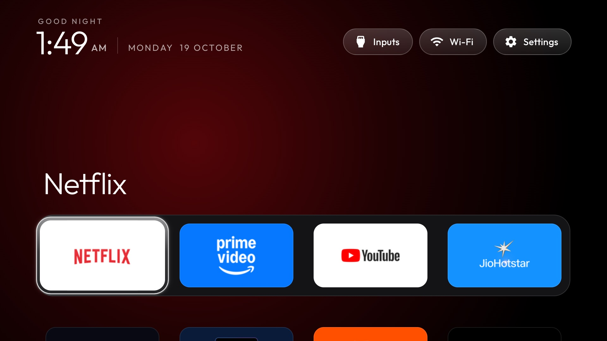

# webos-vibehack

An Apple TV-style home screen for LG TVs. It's a webOS port of the launcher from
[tv-vibehack](https://github.com/Gathin23/tv-vibehack), which does the same for Android TVs.



Tested on an LG OLED C6 (OLED55C6XLA, webOS 26, firmware 43.21.79).

This copy, in the `webos/` folder of a [cleanyourtv](https://github.com/Gathin23/cleanyourtv) fork, is
[OmkarK97's port](https://github.com/OmkarK97/webos-vibehack) with additions, tested on an LG OLED C2
(webOS 25): a liquid glass look, apps grouped into categories, a Photos app fed from Apple Photos,
a Home button that works from the TV alone, a Casting menu, and an optional watcher that quits
the apps you leave so they stop holding memory.

## What's different from Android

webOS is more locked down than Android TV, so three things work differently:

| | Android TV | LG webOS |
|---|---|---|
| Install | ADB, no account | LG's **Developer Mode** app (free LG developer account) |
| App list | read on the TV | read from your computer by `sync-apps.py` and bundled in; webOS won't let an app list installed apps |
| Home button | the launcher *is* Home | webOS always opens LG's home; a service that comes with the launcher switches straight back (about 0.5 s) |

There's no debloat step: webOS has no ADB-style package disabling. Turn off LG's ads in the TV's
own settings instead (see [Cleaning up LG's home](#cleaning-up-lgs-home)).

Nothing is rooted. Developer Mode is LG's official way to install your own apps, firmware updates
keep working, and deleting the Developer Mode app removes everything.

## Setup

You need a Mac on the same Wi-Fi as the TV, with Node.js (for LG's `ares` CLI, fetched with `npx`)
and Python 3. The steps are macOS only for now: `install.sh` makes the app icon with `sips`.

**1. Developer Mode on the TV**

1. Create a free account at [webostv.developer.lge.com](https://webostv.developer.lge.com).
2. On the TV, install **Developer Mode** from the LG Content Store and sign in.
3. Turn on **Dev Mode Status** (the TV restarts), open the app again and turn on **Key Server**.
   Note the **IP address** and **Passphrase** it shows.

**2. Connect your computer** (once)

```bash
export TV_HOST=192.168.1.50                       # the IP from the Developer Mode app
npx -y -p @webos-tools/cli ares-setup-device -a lgtv -i "{'host':'$TV_HOST','port':'9922','username':'prisoner'}"
npx -y -p @webos-tools/cli ares-novacom --device lgtv --getkey        # type the passphrase
npx -y -p @webos-tools/cli ares-setup-device -m lgtv -i "{'privatekey':'lgtv_webos','passphrase':'ABC123'}"
```

**3. Install**

```bash
git clone -b webos https://github.com/koushik1610/cleanyourtv.git
cd cleanyourtv/webos
python3 -m venv venv && venv/bin/pip install websockets
TV_HOST=192.168.1.50 ./install.sh
```

The first run shows an "allow this device?" prompt on the TV: accept it. That pairing lets
`sync-apps.py` read your apps and icons. `install.sh` then packages the app, installs it and opens
it. Run it again whenever you install or remove apps on the TV.

**4. A one-press shortcut**

With the launcher open, hold a number key on the remote (say **1**) and assign it. From then on,
holding 1 opens the launcher from anywhere.

## The Home button

webOS hard-wires Home to LG's home. The launcher's package carries a small JS service
([`service/`](service/)) that fixes that from the TV itself: it listens to the TV's remote-control
service on `localhost:3000` for the app in front and, the moment LG's home appears, opens the
launcher. No computer needed once it's installed. The first start asks on the TV to allow it.

- **Press Home twice** within three seconds to stay on LG's home, for its menus.
- After a power cut or a cold boot, it takes over by itself: a persistent activity starts the
  service again (on a C2, the launcher was in front about a minute and a half after power-on).
- Failsafe: if the launcher doesn't open, or Home bounces more than four times in 20 seconds, the
  service stands down for ten minutes and Home works as on a stock TV.
- `takeOverHome: false` in `config.js` turns it off.

Why a service and not the launcher? webOS freezes a web app's scripts a few seconds after it leaves
the screen (`keepAlive` in `appinfo.json` changes nothing), so the launcher never hears about Home.
A JS service keeps running.

### Quitting the apps you leave (optional, needs another device)

webOS keeps an app in memory after you switch away; on a 2 GB TV a few of them push everything
else into swap, and that's most of the lag. [`home-watch.py`](home-watch.py) closes every app
opened since the launcher was last in front. It has to run on another always-on device on the same
network: tested on a C2, the TV refuses to close apps for anything on the TV itself (the app
manager's `running` and `closeByAppId` are denied to Developer Mode apps and services, with or
without `requiredACG`, and the remote-control service answers a close from localhost with `403
access denied`). It also sends Home to the launcher, which does no harm next to the service.

On a Mac, as a background service that starts at login:

```bash
TV_HOST=192.168.1.50 ./home-watch-mac.sh       # install or update
./home-watch-mac.sh uninstall                  # remove
```

macOS will ask for Local Network access for Python: allow it (System Settings → Privacy & Security →
Local Network), or the watcher logs "No route to host". The log is at
`~/Library/Logs/tv-vibehack-home-watch.log`. A Mac only does this while it's awake and at home;
for every time, run `python3 home-watch.py 192.168.1.50` on something that's always on, such as a
Raspberry Pi.

## Using it

Same as the [Android launcher](https://github.com/Gathin23/tv-vibehack#the-launcher): a dock with the focused app's name above it and a glow in
its colour, the rest of your apps below, and Inputs (HDMI ports and Live TV), Wi-Fi and Settings at
the top. The header slides away when the grid scrolls into it.

The look is liquid glass done cheaply: a static gradient wallpaper, translucent pills and a frosted
plate behind each dock tile, with no `backdrop-filter`, since live blur costs a TV's GPU on every
frame. Below the dock, apps sit in titled categories (Movies & TV, Sports, Games and so on, set in
`config.js`); anything not listed lands in **More**. Tiles size themselves to `columns`.

**Rearrange tiles on the TV**: hold **OK** on a tile until it wiggles, move it with the arrows
(into the top row puts it in the dock), then **OK** to place it or **Back** to cancel. The order is
saved on the TV.

**Configure** in [`app/config.js`](app/config.js): the starting dock, apps to hide, the Live TV
app, the number of columns, the categories and the dock glass. App ids come from `venv/bin/python sync-apps.py $TV_HOST --list`.
Changing `dockApps` resets an order arranged on the TV.

## Casting

The Inputs menu ends with a **Casting** section, from the receivers `sync-apps.py` finds on the
TV (they're hidden system apps, so they never show as tiles):

- **AirPlay** (iPhone, iPad, Mac) and **Google Cast** (Android, Chrome, the Cast button in apps;
  webOS 25 brought it to the C2) are always listening, so there's nothing to switch to: OK says
  where to tap on the phone, with the TV's name as phones show it.
- **Screen Share** (Miracast mirroring from Android phones that have it) has to be started: OK does.

## Photos

A second app, **Photos**, shows the Favorites album from Apple Photos: a grid of everything, and a
slideshow that shuffles them, each photo for four seconds with a random transition (fades, slides
and zooms, all opacity and transform so the GPU does them) and each video played to its end.

```bash
venv/bin/pip install pillow
venv/bin/python sync-photos.py                 # needs ffmpeg for video frames
TV_HOST=192.168.1.50 ./install-photos.sh
```

`sync-photos.py` asks Photos for the album (macOS asks once to let it control Photos), exports each
item once (Photos fetches it from iCloud when needed) and keeps the exports in `photos-cache/`. Each
photo becomes a 1920x1080 slide, the whole photo centred on a blurred, darkened copy of itself, so
the TV does no scaling. Videos go through `avconvert` (HDR to SDR) and are re-encoded at the size
they show at, 30 fps and at most 6 Mbit/s: iPhone clips at 16 Mbit/s made a 4-minute album 436 MB.
Run it again to pick up changes; anything unfavourited is removed. Your photos never go into git.

The icon is yours to choose: `install-photos.sh` resizes `assets/apple-photos-icon.png`, which is
ignored by git. Make one from any square image.

## Memory

Measured on a C2 (2 GB RAM) by opening and closing apps over the Developer Mode shell:

- The load average sits around 14, but that's a dozen LG driver threads in uninterruptible sleep.
  The CPU was 80 to 90% idle.
- Memory is the problem. About 450 MB was in swap at rest; opening Netflix, YouTube and Prime Video
  in turn took available memory from 657 MB to 496 MB, and they stay resident after you switch
  away. Closing them gave back about 200 MB. With the watcher quitting them, going Home took
  available memory from 398 MB to 625 MB.
- Some of it can't be helped: Netflix is preloaded at boot (about 90 MB, and survives closing), and
  LG's home (about 80 MB) always runs.
- Turning off **Quick Start+** makes every power-on a clean boot, and **Live Plus** stops `acr2`.
- The launcher costs about 50 MB, Photos about 37 MB.

## Undo everything

Nothing here changes LG's own apps or settings, roots the TV or touches its firmware: it's two
Developer Mode apps, so the stock TV is always one step away.

```bash
./restore.sh
```

stops the Home service and cancels its start-at-boot activity, removes the launcher and Photos, and
removes the Mac watcher if it's installed. Home opens LG's home again; `./install.sh` puts it back.

Without a computer: press Home twice for LG's home, then delete **Home** and **Photos** from the
app list. Or open the **Developer Mode** app and turn off **Dev Mode Status**, which removes every
app installed through it. If the Developer Mode session runs out, the apps stop opening and the TV
behaves as stock until it's extended.

## Cleaning up LG's home

For when you do land on it. Names vary a little by webOS version:

- **Settings → General → System → Additional Settings → Home Settings**: turn off **Home
  Promotion** and **Content Recommendation**.
- **Settings → Support → Privacy & Terms → User Agreements**: untick **Viewing Information** and
  **Interest-Based Recommendations**.

## Troubleshooting

- **Pairing fails with "403 Pairing rejected: blacklisted certificate detected".** Newer firmware
  rejects the signed manifest that open-source LG clients share. `lgtv.py` pairs with an unsigned
  one, which still works.
- **No pairing prompt on the TV.** Turn on the TV's option for connecting from mobile apps (on the
  C6: Settings → General → Devices → External Devices; named "LG Connect Apps" or similar).
- **`ares` says "All configured authentication methods failed".** The device profile is missing
  its key: run the third command in step 2 again.
- **Apps stop opening after a while.** Developer Mode sessions expire (LG shows the time left in
  the Developer Mode app; it was 999 hours on our C6). Press **Extend Session Time** there.

## Files

| File | What it does |
|---|---|
| [`app/`](app/) | The launcher: `index.html`, `style.css`, `app.js`, `config.js`, `appinfo.json` |
| [`install.sh`](install.sh) | Syncs your apps, packages and installs the launcher and its service, and opens it |
| [`sync-apps.py`](sync-apps.py) | Reads apps, icons, HDMI inputs and casting receivers from the TV into `app/apps.js` and `app/icons/` |
| [`service/`](service/) | Runs on the TV, packaged with the launcher: sends Home to it, starts again after boot |
| [`restore.sh`](restore.sh) | Puts the TV back to stock |
| [`home-watch.py`](home-watch.py) | Optional, on another device: quits the apps you leave (and sends Home to the launcher) |
| [`home-watch-mac.sh`](home-watch-mac.sh) | Runs the watcher as a macOS background service |
| [`lgtv.py`](lgtv.py) | Pairs with and talks to the TV's remote-control service |
| [`assets/icon.jpg`](assets/icon.jpg) | The app icon, resized to PNG by `install.sh` |
| [`photos-app/`](photos-app/) | The Photos app: grid and slideshow |
| [`sync-photos.py`](sync-photos.py) | Brings the Apple Photos Favorites album into `photos-app/` |
| [`install-photos.sh`](install-photos.sh) | Packages and installs Photos, then refreshes the launcher |

## Credits

The design, layout and app icon come from [tv-vibehack](https://github.com/Gathin23/tv-vibehack)
by [Gathin](https://github.com/Gathin23). The Outfit font is under the SIL Open Font License
([`app/fonts/OFL.txt`](app/fonts/OFL.txt)). MIT licensed, see [`LICENSE`](LICENSE).
